<p align="center">
  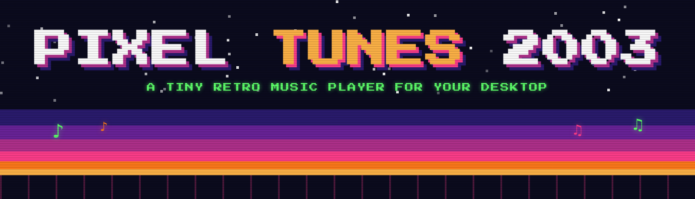
</p>

<p align="center">
  
  
  
  
</p>

<h3 align="center">
  A floating Winamp-style music widget with live pixel-art animations,<br>
  an optional Spotify mode, and a link for tiny ESP32 desk gadgets.
</h3>

<p align="center">
  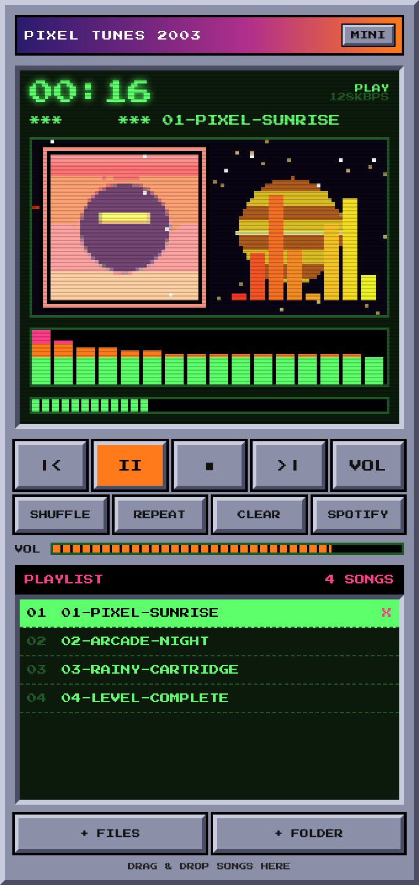
  &nbsp;&nbsp;
  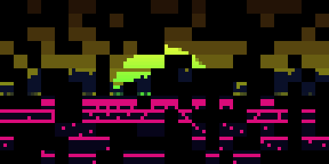
</p>

---

## ✨ What it does

| | |
| --- | --- |
| 🎛️ **Retro widget** | Green LCD screen, chunky buttons, pixel equalizer. No Windows title bar: drag it anywhere and it remembers its spot. |
| 🌆 **Live pixel animation** | Every song gets its own looping scene (neon road, rainy city, space). If the song has cover art, it turns into chunky pixels and flashes with the bass. |
| 🟢 **Spotify mode** | See what Spotify is playing, control it, browse your playlists, and search films, albums and songs without leaving the widget. |
| 🐣 **Pixel pet** | A pet hatches from an egg and grows into 4 more forms the longer you listen. It dances to your songs and gets sad if you stop. |
| 📝 **Synced lyrics** | Lyrics scroll in time with the song. Drop a `.lrc` file in, or let the player look them up online. |
| 🎨 **Skins** | Walkman, Game Boy, Midnight, Sakura, or make your own with a tiny colour file. |
| 🎬 **Share clip** | One click saves an 8-second video of the pixel animation, ready to post. |
| 🎮 **8-BIT mode** | Hear your own song replayed like an old game console: two beepy voices for the tune, a bass voice and little drum sounds. |
| 🌌 **Ambient mode** | Turns your whole screen into a pixel scene with the song name and a clock. |
| 🤖 **Desk Buddy link** | A tiny ESP32 gadget with a screen can show the current song and send play, pause and next. |
| 📌 **MINI and PIN** | Shrink it to just the screen and buttons, or pin it above every other window. |
| 🔋 **Keeps playing** | Plays on when the screen goes black, and only blocks PC sleep while a song is actually playing. |

**Keyboard:** `Space` play/pause · `Left` / `Right` jump 5 seconds · `Up` / `Down` volume · `N` next · `P` previous

---

## 🎵 About music

> [!NOTE]
> **No music is included.** The player plays audio files that **you** add (MP3, WAV, OGG, M4A, FLAC, AAC).
> Please only use music you own or have the right to use, for example CDs you ripped yourself or songs you bought as downloads.
> Songs "downloaded" inside Spotify, JioSaavn, Gaana, YouTube Music or Apple Music are locked inside those apps and cannot be added here.
> (That is what **Spotify mode** below is for.)

### Try it with the demo music

The `demo-music` folder has 4 original 8-bit chiptune tracks made for this project (public domain, CC0):

1. Open Pixel Tunes 2003.
2. Click **+ FOLDER**.
3. Choose the `demo-music` folder.
4. Press the orange play button.

Remove them any time with the red **X** next to a song, or **CLEAR**.

---

## 🚀 Quick start (if you already have Node.js)

```cmd
git clone https://github.com/meetRaval09/music_player_2003.git
cd music_player_2003
npm install
npm start
```

New to all this? Open the full guide just below. It starts from zero.

<details>
<summary><b>📖 Step-by-step install guide for Windows (no experience needed)</b></summary>

<br>

This works on **Windows 10 or 11**.

### Step 1: Install Node.js (one time only)

Node.js is a free program that lets your PC run and build this app.

1. Go to <https://nodejs.org>
2. Click the big green **LTS** button and install it (keep clicking Next).
3. Check it worked: press the Windows key, type `cmd`, press Enter, and type:
   ```
   node -v
   ```
   You should see a number like `v22.x.x`. If it says "not recognized", restart your PC and try again.

### Step 2: Download this project

- On this GitHub page, click the green **Code** button, then **Download ZIP**.
- Right-click the ZIP and choose **Extract All**. Put the extracted folder somewhere permanent, for example `Documents\pixel-tunes-2003`.
  (Don't move it later, because the shortcuts you make will point to it.)

### Step 3: Open a Command Prompt inside the folder

1. Open the extracted folder in File Explorer, so you can see `index.html` and `package.json`.
2. Click the **address bar** at the top of the window, type `cmd`, and press Enter.
   A black window opens, already inside the folder.

### Step 4: Install the parts the app needs

In the Command Prompt, type this and press Enter. Wait until the installation finishes
(about a minute, and you can type again when it's done):

```cmd
npm install
```

### Step 5: Check that Electron installed (important)

Electron is the engine that runs Pixel Tunes 2003. On some PCs, `npm install` finishes without
downloading Electron's files, because newer versions of npm can block Electron's install script.
Do these checks before you try to run the app. They take a minute.

**1. Check whether Electron is installed:**

```cmd
npm ls electron
```

You should see a line like `electron@33.x.x`. If it says `(empty)` or shows an error, run `npm install` again.

**2. Check for blocked install scripts (only if your npm has this command):**

```cmd
npm install-scripts ls
```

If it says `Unknown command`, your npm is older and doesn't block scripts, so skip to part 3.

If `electron` appears in the **blocked** list, approve it:

```cmd
npm install-scripts approve electron
```

If `electron-winstaller` is also in the blocked list, approve it too:

```cmd
npm install-scripts approve electron-winstaller
```

**3. Download Electron's files:**

```cmd
node node_modules\electron\install.js
```

Wait until the download reaches 100%.

**4. Confirm the Electron program exists:**

```cmd
dir node_modules\electron\dist\electron.exe
```

You should see `electron.exe` listed. Then check its version:

```cmd
npx electron --version
```

You should see something like:

```text
v33.4.11
```

The exact numbers may be a little different on your PC. That's fine, as long as a version number appears.

### Step 6: Run it

```cmd
npm start
```

The Pixel Tunes 2003 player should now open. Close it with its **X** button when you're done trying it.

### Step 7: Make a real app you can double-click

```
npm run build
```

This takes a few minutes the first time. When it finishes, your app is here:

```
dist\win-unpacked\Pixel Tunes 2003.exe
```

> [!IMPORTANT]
> Keep the `.exe` inside its `win-unpacked` folder. It needs the other files next to it.
> Don't copy the `.exe` alone. Make a **shortcut** to it instead (next step).

### Step 8: Put a shortcut on your Desktop

Right-click `Pixel Tunes 2003.exe`, choose **Show more options**, then **Send to**, then **Desktop (create shortcut)**.

### Step 9 (optional): Start it automatically with Windows

1. Right-click `Pixel Tunes 2003.exe`, choose **Show more options**, then **Create shortcut**.
2. Cut that shortcut (right-click, **Cut**).
3. Press `Win + R`, type `shell:startup`, press Enter, then right-click an empty spot and **Paste**.

To stop it starting with Windows, delete that shortcut from the same folder.
(You can also use Task Manager: `Ctrl + Shift + Esc`, then **Startup apps**, then right-click **Pixel Tunes 2003**, then **Disable**.)

</details>

---

## 🕹️ Using the player

1. Click **+ FOLDER** to load a whole folder of songs, or **+ FILES** to pick songs. You can also drag songs from File Explorer into the player.
2. Click a song in the playlist, or press the orange **>** button.
3. Hover over a song and click the red **X** to remove it. **CLEAR** removes everything.
4. **MINI** shrinks the widget. Press **FULL** to bring the playlist back.
5. **PIN** keeps the widget above all other windows (off by default, so it stays behind your apps).
6. **_** hides it to the taskbar, and **X** closes it.

### The extras (row of small buttons under SHUFFLE)

| Button | What it does |
| --- | --- |
| **PET** | Meet your pixel pet. Play music to feed it. Click it to give it love, and type a name for it. |
| **LYRICS** | Shows synced lyrics for the current song (MP3 or Spotify). Lyrics come from [LRCLIB](https://lrclib.net), a free lyrics site: only the song name and artist are sent. To use your own, drop a `.lrc` file with the **same name as the song** into the player along with your songs. |
| **SKIN** | Pick a look. **[ MAKE YOUR OWN SKIN ]** opens a folder with an example `my-skin.json`: change the colours (like `"chassis": "#8fb8a0"`), save, and reopen SKIN. |
| **CLIP** | While a song plays, records 8 seconds of the animation as a square video and saves it in **Videos > Pixel Tunes clips**. The clip has no sound, so you can add your own music when you post it. |
| **AMBIENT** | Full-screen pixel scene, like a screensaver. Click or press `Esc` to go back. |
| **8-BIT** | Click once for chiptune only, again for chiptune mixed with the real song, a third time to turn it off. It listens to the song and re-plays the notes with game-console beeps. Works with your own song files (not Spotify). |

#### 👀 See them in action

<p align="center">
  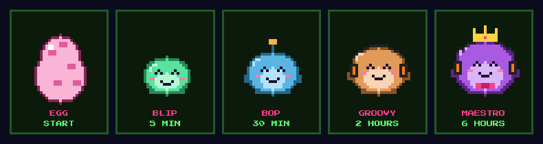<br>
  <sub><b>Your pet grows</b> the more music you play: Egg, Blip, Bop, Groovy, Maestro</sub>
</p>

<table align="center">
  <tr>
    <td align="center" valign="top">
      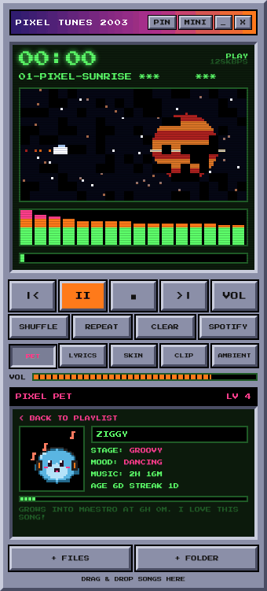<br>
      <b>PET</b><br><sub>dances to your music</sub>
    </td>
    <td align="center" valign="top">
      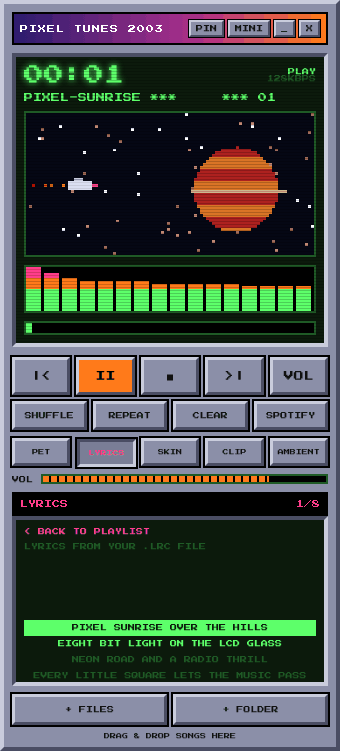<br>
      <b>LYRICS</b><br><sub>scroll in time with the song</sub>
    </td>
    <td align="center" valign="top">
      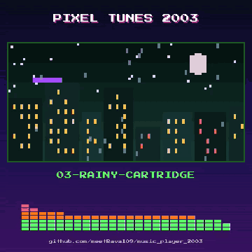<br>
      <b>CLIP</b><br><sub>8-second video to share<br><a href="docs/clip-sample.mp4">watch the full sample (MP4)</a></sub>
    </td>
  </tr>
</table>

<p align="center">
  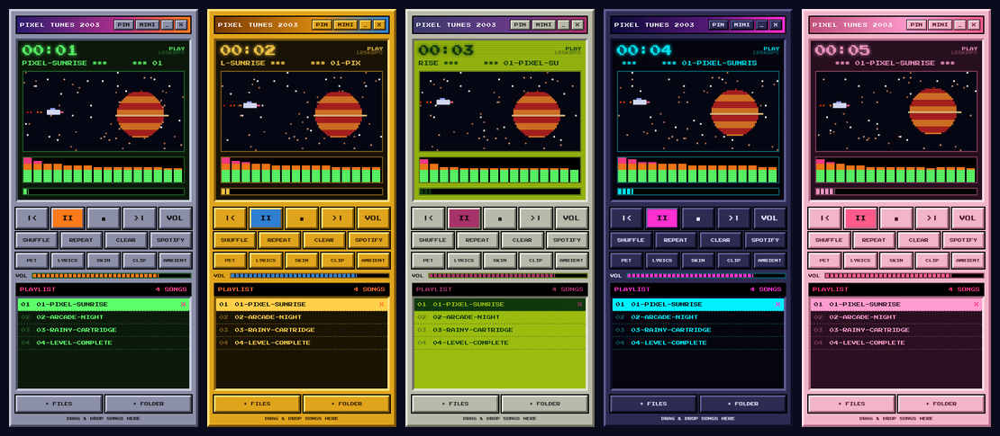<br>
  <sub><b>SKINS</b>: Classic, Walkman, Game Boy, Midnight, Sakura (or make your own)</sub>
</p>

<p align="center">
  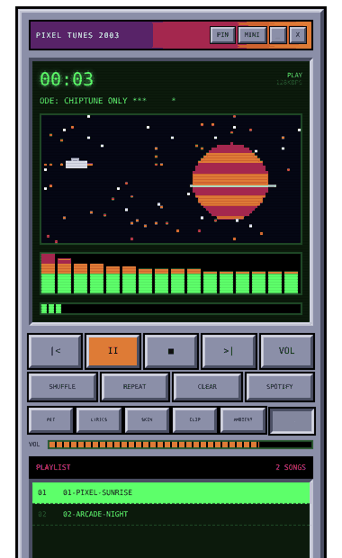<br>
  <sub><b>8-BIT</b>: the song replayed as game-console beeps</sub>
</p>

<p align="center">
  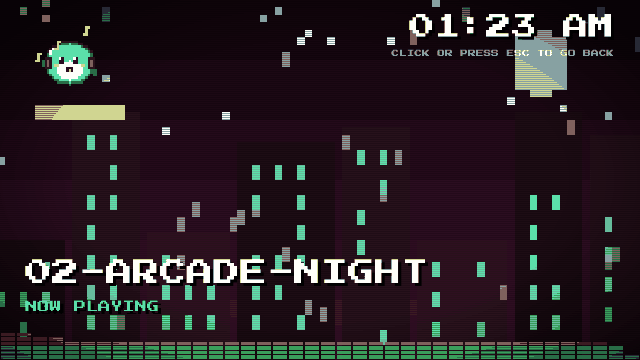<br>
  <sub><b>AMBIENT</b>: your whole screen becomes a pixel scene</sub>
</p>

Your playlist is stored inside the app on your PC. It is not uploaded anywhere.

---

## 🟢 Spotify mode (optional, Windows)

Click **SPOTIFY** (next to CLEAR) to switch between your own MP3s and Spotify.

| What you get | What you need |
| --- | --- |
| **Now playing + buttons** (song, artist, cover art animation, play / pause / next / previous) | Just the Spotify desktop app. No login: the player reads the song from Windows' own media controls. |
| **Your playlists** | One-time setup below, and Spotify Premium |
| **Search** for films, albums and songs, with suggestions as you type. Open an album to see all its songs, or play the whole album. | One-time setup below, and Spotify Premium |

<details>
<summary><b>One-time setup for playlists and search</b></summary>

<br>

1. Verify your email on your Spotify account, then open `developer.spotify.com/dashboard` and click **Create app**.
2. Give it any name. Add the Redirect URI `http://127.0.0.1:8766/callback` exactly, and tick **Web API**, then save.
3. Open the app's **Settings** and copy the **Client ID**.
4. In the player, click **SPOTIFY**, paste the Client ID, click **SAVE CLIENT ID**, then **CONNECT SPOTIFY** and press Agree in your browser.
5. Your playlists appear in the list. You only do this once.

Good to know:

- Spotify only shares the songs of playlists you created or collaborate on. For other playlists you will see just the name.
- Search shows 10 results per page (Spotify's rule for new apps). Use **MORE RESULTS** for more.
- Playing a song needs the Spotify desktop app. If it is closed, the player tries to start it for you (this can take a few seconds the first time).
- Only your Client ID and your login token are stored, on your PC. No password and no client secret is used.

</details>

---

## 🤖 Desk Buddy (optional gadget link)

While the player runs, it opens a small server on your home network (port `8765`, protected by a secret key you can change in `main.js`).
A small ESP32 board with an OLED or a 16x2 LCD can ask it what is playing and show the song name and time, or send play, pause and next.
Allow Pixel Tunes through Windows Firewall on **Private** networks when Windows asks.
The Desk Buddy can also show your pixel pet on its screen (the PET page, one button press after TIME and SONG). The ESP32 sketches are not in this repository yet.

<p align="center">
  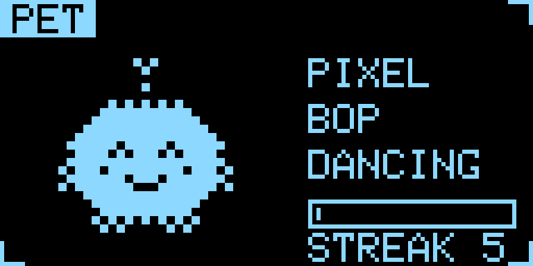<br>
  <sub><b>DESK BUDDY</b>: your pet, its stage and mood on the tiny OLED</sub>
</p>

---

## 🛠️ Troubleshooting

<details>
<summary><b>Click to open the list</b></summary>

<br>

| Problem | What to do |
| --- | --- |
| `npm start` says Electron is missing or `electron.exe` not found | Do **Step 5** again, especially `node node_modules\electron\install.js` |
| `node` or `npm` is "not recognized" | Install Node.js (Step 1), then restart your PC |
| Build error: "Cannot create symbolic link ... privilege" | Open Command Prompt as **Administrator** (right-click, Run as administrator), go to the folder, run `npm run build` again. Or turn on **Developer Mode** in Settings, System, For developers |
| Build error: "Access is denied" or "EBUSY ... resource busy or locked" | The player is still running. Close it in Task Manager (`Ctrl + Shift + Esc`, right-click **Pixel Tunes 2003**, **End task**), then run `npm run build` again |
| The new version doesn't show up after a rebuild | The old one is still running. The app only allows one copy, so opening the new `.exe` just brings the old window forward. End it in Task Manager first |
| Widget does not start with Windows | Check the shortcut is in `shell:startup`, and that it isn't **Disabled** in Task Manager under **Startup apps** |
| Music stops when the PC is left alone | Settings, System, Power, then set **Make my device sleep after** to **Never** while plugged in. Closing a laptop lid also sleeps the PC |
| A song says "CANNOT PLAY THIS FILE" | The file type isn't supported or is damaged. Try an MP3 |
| Widget is off-screen after changing monitors | Delete the file `%APPDATA%\pixel-tunes-2003\window.json` and open the app again |
| Spotify opens by itself at startup | That is Spotify's own setting, not this app. Disable it in Task Manager under **Startup apps** |
| Spotify login says "INVALID_CLIENT: Invalid redirect URI" | In your Spotify developer app settings, add `http://127.0.0.1:8766/callback` exactly and press Save |

</details>

---

## 👩‍💻 For developers

| File | What it does |
| --- | --- |
| `index.html` | The whole player: look, buttons, playlist, visualizer, audio logic, Spotify screens |
| `main.js` | Creates the frameless widget window, remembers its position, blocks sleep during playback |
| `preload.js` | Safe bridge between the page and the window controls |
| `pixelart.js` | The pixel animation screen (scenes, cover-art pixelation, beat reaction) |
| `extras.js` | Pet, lyrics, skins, clip recording and ambient mode |
| `spotify-link.js`, `spotify-helper.ps1` | Reads and controls the Spotify desktop app through Windows media controls |
| `spotify-web.js` | Spotify Web API: PKCE login, playlists, search, albums, play |
| `buddy-server.js` | Local server for the ESP32 Desk Buddy |
| `package.json` | App info and build settings (`electron-builder`, Windows `dir` target) |
| `demo-music/` | 4 original chiptune demo tracks (CC0) so you can try the player |

```bash
npm install     # install dependencies
npm start       # run in development
npm run build   # build dist/win-unpacked/Pixel Tunes 2003.exe
```

The pixel font is bundled through the `@fontsource/press-start-2p` package, so the app works offline.
Songs are stored in the browser's IndexedDB inside the app's own data folder.

### Sharing a ready-to-run version (no Node.js needed for others)

After `npm run build`, zip the whole `dist\win-unpacked` folder and upload the zip to this repository's
**Releases** page. People can then download it, unzip it, and double-click `Pixel Tunes 2003.exe`.
Windows may show a blue "Windows protected your PC" box because the app isn't code-signed:
click **More info**, then **Run anyway**.

---

## 📜 License

MIT License. Free to use, change and share. See the [LICENSE](LICENSE) file.

<p align="center">
  <br>
  Made with ♥ and way too many pixels by <a href="https://github.com/meetRaval09">Meet Raval</a>
</p>
