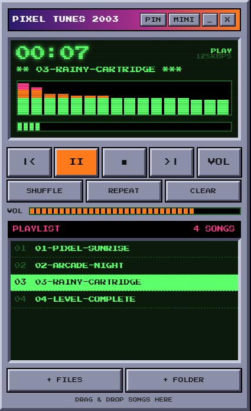

# Pixel Tunes 2003

A tiny retro desktop music-player **widget** for Windows, with a pixelated early-2000s look.
Built with Electron and plain HTML/CSS/JS.



## Features

- Pixel-art, Winamp-style player with a green LCD screen and a pixel equalizer
- Floating widget with no Windows title bar: drag it anywhere, it remembers where you left it
- **MINI** mode (screen and buttons only) and **PIN** (always on top, off by default)
- Play, Pause, Stop, Next, Previous, Shuffle, Repeat, seek bar, volume
- Your playlist is saved on your PC, so your songs are still there next time
- Keeps playing when the screen turns black (it only blocks PC sleep while a song is playing)
- Keyboard shortcuts: `Space` play/pause, `Left/Right` jump 5 seconds, `Up/Down` volume, `N` next, `P` previous

## About music

**No music is included.** The player plays audio files that **you** add
(MP3, WAV, OGG, M4A, FLAC, AAC). Please only use music you own or have the right to use,
for example CDs you ripped yourself or songs you bought as downloads.

Songs "downloaded" inside Spotify, JioSaavn, Gaana, YouTube Music or Apple Music subscriptions are locked
inside those apps and cannot be added here.

### Try it with the demo music

The `demo-music` folder in this repository has 4 original 8-bit chiptune tracks made for this project
(public domain, CC0). To try the player right away:

1. Open Pixel Tunes 2003.
2. Click **+ FOLDER**.
3. Choose the `demo-music` folder.
4. Press the orange play button.

The player keeps its own copy of songs you add. Remove the demo songs any time with the red **X** next to a song, or **CLEAR**.

---

# How to install on your PC (step by step, no experience needed)

This works on **Windows 10 or 11**.

## Step 1: Install Node.js (one time only)

Node.js is a free program that lets your PC run and build this app.

1. Go to <https://nodejs.org>
2. Click the big green **LTS** button and install it (keep clicking Next).
3. Check it worked: press the Windows key, type `cmd`, press Enter, and type:
   ```
   node -v
   ```
   You should see a number like `v22.x.x`. If it says "not recognized", restart your PC and try again.

## Step 2: Download this project

- On this GitHub page, click the green **Code** button, then **Download ZIP**.
- Right-click the ZIP and choose **Extract All**. Put the extracted folder somewhere permanent, for example `Documents\pixel-tunes-2003`.
  (Don't move it later, because the shortcuts you make will point to it.)

## Step 3: Open a Command Prompt inside the folder

1. Open the extracted folder in File Explorer, so you can see `index.html` and `package.json`.
2. Click the **address bar** at the top of the window, type `cmd`, and press Enter.
   A black window opens, already inside the folder.

## Step 4: Install the parts the app needs

In the black window type this and press Enter. Wait about a minute until you can type again:

```
npm install
```

## Step 5: Run it

```
npm start
```

The pixel player opens. Close it with its **X** button when you're done trying it.

## Step 6: Make a real app you can double-click

```
npm run build
```

This takes a few minutes the first time. When it finishes, your app is here:

```
dist\win-unpacked\Pixel Tunes 2003.exe
```

> **Important:** keep the `.exe` inside its `win-unpacked` folder. It needs the other files next to it.
> Don't copy the `.exe` alone. Make a **shortcut** to it instead (next step).

## Step 7: Put a shortcut on your Desktop

Right-click `Pixel Tunes 2003.exe`, choose **Show more options**, then **Send to**, then **Desktop (create shortcut)**.

## Step 8 (optional): Start it automatically with Windows

1. Right-click `Pixel Tunes 2003.exe`, choose **Show more options**, then **Create shortcut**.
2. Cut that shortcut (right-click, **Cut**).
3. Press `Win + R`, type `shell:startup`, press Enter, then right-click an empty spot and **Paste**.

To stop it starting with Windows, delete that shortcut from the same folder.
(You can also use Task Manager: `Ctrl + Shift + Esc`, then **Startup apps**, then right-click **Pixel Tunes 2003**, then **Disable**.)

---

# Using the player

1. Click **+ FOLDER** to load a whole folder of songs, or **+ FILES** to pick songs.
   You can also drag songs from File Explorer into the player.
2. Click a song in the playlist, or press the orange **>** button.
3. Hover over a song and click the red **X** to remove it. **CLEAR** removes everything.
4. **MINI** shrinks the widget. Press **FULL** to bring the playlist back.
5. **PIN** keeps the widget above all other windows (off by default, so it stays behind your apps).
6. **_** hides it to the taskbar, and **X** closes it.

Your playlist is stored inside the app on your PC. It is not uploaded anywhere.

---

# Troubleshooting

| Problem | What to do |
| --- | --- |
| `node` or `npm` is "not recognized" | Install Node.js (Step 1), then restart your PC |
| Build error: "Cannot create symbolic link ... privilege" | Open Command Prompt as **Administrator** (right-click, Run as administrator), go to the folder, run `npm run build` again. Or turn on **Developer Mode** in Settings, System, For developers |
| Build error: "Access is denied" | The player is still running. Close it in Task Manager (`Ctrl + Shift + Esc`, right-click **Pixel Tunes 2003**, **End task**), then run `npm run build` again |
| Widget does not start with Windows | Check the shortcut is in `shell:startup`, and that it isn't **Disabled** in Task Manager under **Startup apps** |
| Music stops when the PC is left alone | Settings, System, Power, then set **Make my device sleep after** to **Never** while plugged in. Closing a laptop lid also sleeps the PC |
| A song says "CANNOT PLAY THIS FILE" | The file type isn't supported or is damaged. Try an MP3 |
| Widget is off-screen after changing monitors | Delete the file `%APPDATA%\pixel-tunes-2003\window.json` and open the app again |
| Spotify opens by itself at startup | That is Spotify's own setting, not this app. Disable it in Task Manager under **Startup apps** |

---

# For developers

| File | What it does |
| --- | --- |
| `index.html` | The whole player: look, buttons, playlist, visualizer, audio logic |
| `main.js` | Creates the frameless widget window, remembers its position, blocks sleep during playback |
| `preload.js` | Safe bridge between the page and the window controls |
| `package.json` | App info and build settings (`electron-builder`, Windows `dir` target) |
| `demo-music/` | 4 original chiptune demo tracks (CC0) so you can try the player |

Commands:

```bash
npm install     # install dependencies
npm start       # run in development
npm run build   # build dist/win-unpacked/Pixel Tunes 2003.exe
```

The pixel font is bundled through the `@fontsource/press-start-2p` package, so the app works offline.
Songs are stored in the browser's IndexedDB inside the app's own data folder.

## Sharing a ready-to-run version (no Node.js needed for others)

After `npm run build`, zip the whole `dist\win-unpacked` folder and upload the zip to this repository's
**Releases** page. People can then download it, unzip it, and double-click `Pixel Tunes 2003.exe`.
Windows may show a blue "Windows protected your PC" box because the app isn't code-signed:
click **More info**, then **Run anyway**.

## License

Add a license of your choice (for example MIT) before publishing, by clicking **Add file, Create new file**
on GitHub and naming it `LICENSE`. GitHub offers license templates.
